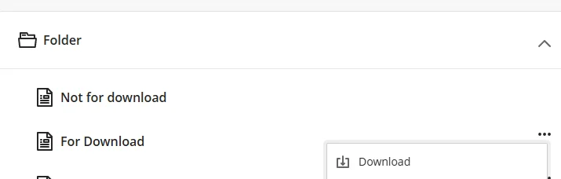
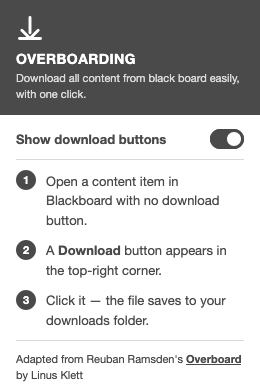

<h1>Overboarding</h1>

<em>Download all content from Blackboard easily, with one click.</em>

Overboarding is a browser extension for Firefox (including Zen) and Chrome. When a file in the Blackboard document viewer has no download option, it adds a **Download** button to the viewer toolbar.

Adapted from Reuban Ramsden's [Overboard](https://github.com/reubxn/OverBoard) by Linus Klett.

## What it does

- Adds a **Download** button to the top-right of the Blackboard document viewer.
- Saves the file with a proper name and extension (`.pdf`, `.docx`, `.pptx`, …) instead of a bare ID.
- Lets you hide or show the button from the extension popup.

<em>Locked content (no download option) next to normal downloadable content</em>

## Install

First, clone or download this repository.

### Firefox and Zen

**Temporary** (removed when the browser restarts):

1. Open `about:debugging#/runtime/this-firefox`.
2. Click **Load Temporary Add-on…** and select `manifest.json`.

**Permanent:**

1. Open `about:addons`, click the gear icon and choose **Install Add-on From File…**.
2. Select `overboarding-firefox-1.0.xpi` from this repository.

To build the package yourself, run `npx web-ext build`; it is written to `web-ext-artifacts/`.

Zen, Firefox Developer Edition and Nightly need `xpinstall.signatures.required` set to `false` in `about:config` to install an unsigned package. Regular Firefox only installs packages signed by [addons.mozilla.org](https://addons.mozilla.org/developers/).

### Chrome

1. Open `chrome://extensions` and enable **Developer mode**.
2. Click **Load unpacked** and select the repository folder.

## Use

1. Open a content item in Blackboard that has no download option.
2. Click the **Download** button in the top-right corner of the viewer.
3. The file is saved to your downloads folder.

### Hide or show the button

Click the Overboarding icon in the browser toolbar and switch **Show download buttons** off or on. The change applies to open Blackboard tabs immediately and is remembered. The button is shown by default.

## How it works

Blackboard's document viewer carries the real file URL in its own address, as `pdfUrl` for PDFs or `originalUrl` for other files. Overboarding reads that URL and hands it to the browser's download manager. If the file has no usable name, the extension works out the extension from the server's response.

## Credits and license

Overboarding is adapted from [Overboard](https://github.com/reubxn/OverBoard) by Reuban Ramsden, who wrote the original extension. Firefox support, file naming, the show/hide switch and the redesign are by Linus Klett.

The original repository does not include a license, so this one does not add one either. Rights to the original code remain with Reuban Ramsden.
